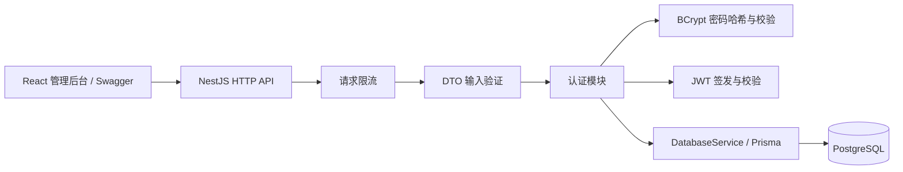

# 项目架构

后端采用 NestJS 模块结构，使用 TypeScript / ESM；通过 Prisma PostgreSQL adapter 连接数据库。前端暂保留 React / Vite 骨架，后续实现 Ant Design 管理界面。

- `DatabaseModule`：管理 Prisma 生命周期，启动连接、关闭时释放连接池。
- `AuthModule`：注册、登录、当前用户；导出 JWT Guard，供后续商品与分类接口保护。
- `CategoriesModule`：共享分类 CRUD、分页搜索、商品数量；通过数据库外键阻止删除引用中的分类。
- `ProductsModule`：共享商品查询、创建、分页搜索与分类筛选；修改与删除检查创建者，并在写入条件中再次限定 userId。
- `configure-app.ts`：统一 `/api` 前缀、DTO 验证、CORS 和 Swagger，并与集成测试共用配置。
- `prisma/`：schema 与版本迁移；开发迁移使用独立影子库。
- `test/`：真实数据库 HTTP 测试；`scripts/`：建库及底层数据库约束验证。

真实密码和密钥只存在本地 `.env`。用户查询显式选择公开字段；JWT 只包含用户标识、签发时间、有效期及系统标识。默认请求限流使用单进程内存，不适用于共享多实例计数。

商品与分类控制器统一使用 JWT Guard。商品金额从 API 输入到输出都使用字符串，由 Prisma Decimal 和 PostgreSQL numeric 保存；列表及计数在同一 Repeatable Read 快照读取。前端管理页面、容器部署和完整系统回归在后续阶段补齐。
