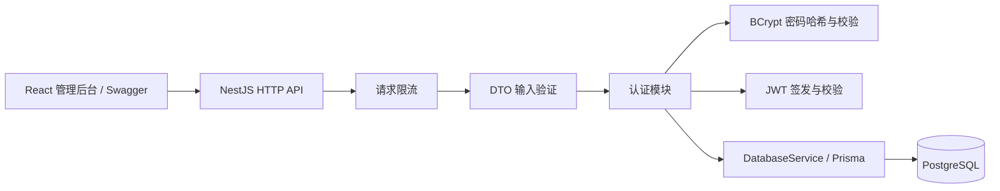

# 项目架构

## 库存流水

StockMovementsModule 提供只读查询与 JWT/权限/数据范围检查。事务内 writer 被商品初始化、手动调整及订单扣补调用，接受同一个 Prisma TransactionClient；不单独开启事务，不自行递增库存版本。商品更新在行锁后读取前值、复核归属与版本，库存与流水一起提交，提交后才通知 Socket。缺货、唯一键或流水写入异常均回滚业务。

前端商品详情和订单详情复用 StockMovements 组件；实时刷新保留当前查询，订单链接同时取决于 order:read 和后端 canViewOrder。副本只复制主库结果，桥按源事务应用，流水独立使用追加重放分支，相同 UUID 必须类型化内容完全相同，否则整事务失败；不靠较新时间戳覆盖历史记录。规格与限制见 [库存流水](stock-movements.md)。

后端采用 NestJS 模块结构，使用 TypeScript / ESM；通过 Prisma PostgreSQL adapter 连接数据库。前端采用 React / Vite、Ant Design、React Router 和 Axios。

工程使用 npm workspaces 管理 backend/frontend，根目录单一锁文件；Turborepo 编排构建、代码检查与隔离测试。Prisma Client 在后端构建前生成；构建使用本地缓存，集成测试禁用缓存。Docker 以根目录为构建上下文，保留应用目录及各自运行依赖；具体任务和环境配置见 [工具链说明](tooling.md)。

图片上传由独立 `UploadModule` 处理：JWT Guard 先鉴权，Multer 限制 multipart 单文件并暂存在内存，服务校验扩展名/MIME/签名后以 UUID 写入 `./uploads`。Express 通过 `/uploads` 提供公开静态访问；商品表只保存可空封面 URL。前端 `CoverImageUpload` 通过统一 Axios 封装上传，作为受控表单字段写入 URL，并提供预览、清空和错误反馈。开发代理与 Nginx 转发图片路径，Docker 将目录绑定到 `backend/uploads`，使容器重建后文件保留，且本机开发使用同一目录。接口约定和变更清单见 [商品图片功能](product-images.md)。

- `DatabaseModule`：管理 Prisma 生命周期，启动连接、关闭时释放连接池。
- `AuthModule`：注册、登录、当前用户；导出 JWT Guard 与 PermissionsGuard，读取关联的有效角色、权限和数据范围，拒绝副本业务认证。
- `RolesModule`：固定权限目录、角色配置、OWN/ALL 范围、审计与旧凭证撤销；AdminModule 负责用户角色分配。
- `CategoriesModule`：分类全局共享，读写分别按权限授权；分页搜索、商品数量；通过数据库外键阻止删除引用中的分类。
- `ProductsModule`：商品列表和详情按 product:read 的 OWN/ALL 范围查看；默认角色共享读取；列表和计数共用筛选 where；写条件单独附带归属，管理员可写全部，运营人员仅自己。
- `configure-app.ts`：统一 `/api` 前缀、DTO 验证、CORS 和 Swagger，并与集成测试共用配置。
- `prisma/`：schema 与版本迁移；开发迁移使用独立影子库。
- `test/`：真实数据库 HTTP 测试；`scripts/`：建库及底层数据库约束验证。

真实密码和密钥只存在本地 `.env`。用户查询显式选择公开字段；JWT 包含用户标识、tokenVersion、签发时间、有效期及系统标识；角色以每请求数据库读取为准，不信任 JWT 或前端角色声明。默认请求限流使用单进程内存，不适用于共享多实例计数。

商品与分类控制器统一使用 JWT Guard。商品金额从 API 输入到输出都使用字符串，由 Prisma Decimal 和 PostgreSQL numeric 保存；列表及计数在同一 Repeatable Read 快照读取。

## 前端结构

- `api/`：类型化 API 与 Axios 拦截器，附加 Bearer 令牌并处理当前会话的 401，避免旧请求清除新会话。
- `auth/`：登录状态与 sessionStorage；启动时通过 `/auth/me` 恢复用户，网络错误保留令牌并提供重试。
- `pages/`：注册登录、商品目录与详情、分类管理；路由按页面延迟加载。
- `components/`：商品表单、可远程搜索及分页加载的分类选择器、加载和错误反馈。
- `hooks/useResource.ts`：取消已失效的读取请求，统一加载、错误与刷新状态。
- `layouts/`：桌面侧栏与移动端导航；`e2e/`：真实浏览器及真实后端的操作验证。

前端路由保护改善访问体验，数据权限由后端 JWT Guard 和归属检查保证。令牌保存在当前浏览器标签页的 sessionStorage；关闭标签页或退出会清除本地会话。生产环境应使用 HTTPS、同源 `/api` 反向代理和 SPA 路由回退。

## 容器结构

Compose 管理 PostgreSQL、一次性迁移、NestJS 与 Nginx 前端四个服务。数据库健康后先运行迁移，迁移成功才启动 API，API 健康后启动前端入口。数据库数据保存于独立命名卷，应用以普通数据库账号连接；后端运行镜像只保留生产依赖，并以 node 用户启动。

多阶段构建通过 npm ci 安装 Linux 依赖和生成 Prisma 客户端，宿主机依赖、构建产物和环境凭据通过 .dockerignore 排除。Nginx 提供 SPA 路由回退，并在容器网络中代理 API 和 Swagger；宿主机只暴露本地 8088 入口。配置与维护见 [部署指南](deployment.md)。

可选 `docker-compose.sync.yml` 增加 `db-sync` 常驻进程，通过 `host.docker.internal` 访问本机项目库。两端业务行触发器与写事务共同记录持久事件，进程在目标库事务内比较版本并应用、提交后确认源事件；远端应用不重复捕获。断线自动补传，删除保留版本，约束冲突保留待处理事件。它提供最终一致性，不能替代跨库事务；同一记录并发更新按较新的整行版本处理。

## 个人中心与会话失效

UsersModule 仅允许基于 JWT 身份查看资料、修改邮箱与独立改密；AuthModule 在登录/注册签发版本声明，JwtAuthGuard 每次直查用户版本。修改密码在同一事务更新 BCrypt 哈希和递增版本，不发新凭证。前端复用统一 401 清理与登录跳转，个人中心提供资料与密码两张表单。两库通过现有桥接同步版本与哈希，存在异步延迟；详见 [个人中心说明](personal-center.md)。

## 角色权限

新增 AdminModule 提供管理员账号列表与角色调整；AuthModule 的 PermissionsGuard 读取 RequirePermissions 元数据，缺少权限声明默认拒绝。JWT Guard 先校验签名、过期和版本，再将数据库角色映射为公开权限。ProductsService 的共享读取使用同一个筛选 where 传给 findMany 和 count；productScope 仅用于修改/删除，实际写入 where 保留归属限制。运营人员不能通过指定资源 ID 修改或删除他人商品。

前端 RequirePermission 控制直接路由访问，can/canManageProduct 控制菜单和操作入口；这些仅改善界面，后端独立鉴权。角色调整与审计/版本递增采用单库事务，受控首次管理员脚本复用同一事务锁。同步桥传递 role 并保护较高版本的角色和密码；审计记录保留在发起操作的数据库。异步双库不提供跨库角色变更串行化，详见 [RBAC](rbac.md)。

登录页通过 loginRole 声明所选入口，AuthService 在密码核验成功后比对数据库角色；令牌及权限仍来自数据库，入口选择不会提升角色。旧客户端可省略 loginRole。

注册提供 OPERATOR 与 ADMIN 选择，默认 OPERATOR。管理员注册在服务端验证 ADMIN_REGISTRATION_COMPANY_ID；未配置时关闭管理员注册，校验值不存数据库、不返回、不写入前端。历史角色审计列改为文本以保留原始证据，当前用户角色枚举只保留两项。

## 实时通知模块

RealtimeModule 导入 AuthModule，共享 AccessTokenService，与 HTTP Guard 使用相同 JWT 和数据库 tokenVersion 验证。商品、分类及用户安全服务导入 RealtimeModule，仅在写入/事务提交后通知；AuthModule 不反向依赖 RealtimeModule，避免循环依赖。网关无业务写 handler，连接注册表只包含已认证连接；过期定时与 30 秒版本检查负责失效清理。前端 AuthProvider 内集中挂载 RealtimeProvider，通过订阅 hook 和 300ms 刷新队列重新调用 REST。无需新表；数据库直改、多实例与可靠投递边界见 [实时通知规格](realtime.md)。

## 订单模块与双库一致性

OrdersModule独立组织Controller/DTO/Service；复用JWT、权限Guard、DatabaseModule和RealtimeModule。CommerceModule检查写入角色，SQL触发器提供副本写保护。OrdersService使用事务幂等锁、按UUID排序的商品行锁、带归属的订单行锁及写条件，订单/明细/日志与库存原子提交。商品库存乐观版本阻止旧编辑表单覆盖已扣库存。

订单事件只投递创建人/管理员，商品库存事件仍共享广播；前端列表和详情复用300ms合并、重连补拉，保留URL查询。订单无物理删除或自由状态编辑接口。

同步桥在PRIMARY/REPLICA部署按transaction_id复制完整源事务；目标提交后才确认源队列，失败停止本方向后续组，重放使用原事件版本。一次102事件的大订单不会受旧100行批量上限拆分。用户/分类仍双向；商品与订单强制Docker主写。STANDALONE保留隔离开发兼容，不用于生产双主库存。

## 可配置 RBAC

前端五个管理列表通过 `ManagementPageHeading` 复用商品管理的标题结构、字号、说明与操作区。订单列表使用与其他列表相同的内容宽度，标题在小屏换行；详情、录单和个人中心继续使用各自页面布局。

账号生命周期由 AdminModule 内独立 AccountLifecycleService 承担，与角色调整共用事务权限锁。删除/恢复与 tokenVersion、审计同事务，提交后撤销 Socket；认证及个人资料写入排除已删除账号。硬删除要求系统管理员及权限点，用户行锁与 RESTRICT 外键保护商品/订单，写入永久 UUID 墓碑后删除账号。双库的生命周期状态单主复制，独立主库版本与永久墓碑分别防止资料事件覆盖和已删除 UUID 复活；不改变分类/订单业务逻辑。规格见 [账号生命周期](account-lifecycle.md)。

授权链：JWT → 当前用户/tokenVersion → enabled Role → Permission Guard → 按操作 OWN/ALL 的 Service 条件 → Prisma。列表和 count 共享 where。角色编辑/用户分配经事务锁复核权限，审计与版本递增同事务，提交后断开相关 Socket。权限配置单主写入；业务鉴权拒绝只读副本；同步桥按源事务复制角色、权限和用户版本。详见 [RBAC](rbac.md)。
