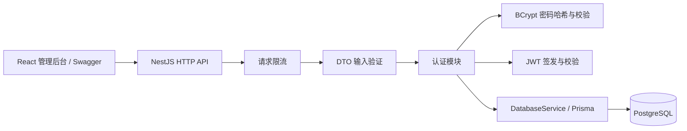

# 项目架构

后端采用 NestJS 模块结构，使用 TypeScript / ESM；通过 Prisma PostgreSQL adapter 连接数据库。前端采用 React / Vite、Ant Design、React Router 和 Axios。

- `DatabaseModule`：管理 Prisma 生命周期，启动连接、关闭时释放连接池。
- `AuthModule`：注册、登录、当前用户；导出 JWT Guard，供后续商品与分类接口保护。
- `CategoriesModule`：共享分类 CRUD、分页搜索、商品数量；通过数据库外键阻止删除引用中的分类。
- `ProductsModule`：共享商品查询、创建、分页搜索与分类筛选；修改与删除检查创建者，并在写入条件中再次限定 userId。
- `configure-app.ts`：统一 `/api` 前缀、DTO 验证、CORS 和 Swagger，并与集成测试共用配置。
- `prisma/`：schema 与版本迁移；开发迁移使用独立影子库。
- `test/`：真实数据库 HTTP 测试；`scripts/`：建库及底层数据库约束验证。

真实密码和密钥只存在本地 `.env`。用户查询显式选择公开字段；JWT 只包含用户标识、签发时间、有效期及系统标识。默认请求限流使用单进程内存，不适用于共享多实例计数。

商品与分类控制器统一使用 JWT Guard。商品金额从 API 输入到输出都使用字符串，由 Prisma Decimal 和 PostgreSQL numeric 保存；列表及计数在同一 Repeatable Read 快照读取。容器部署与交付回归在后续阶段补齐。

## 前端结构

- `api/`：类型化 API 与 Axios 拦截器，附加 Bearer 令牌并处理当前会话的 401，避免旧请求清除新会话。
- `auth/`：登录状态与 sessionStorage；启动时通过 `/auth/me` 恢复用户，网络错误保留令牌并提供重试。
- `pages/`：注册登录、商品目录与详情、分类管理；路由按页面延迟加载。
- `components/`：商品表单、可远程搜索及分页加载的分类选择器、加载和错误反馈。
- `hooks/useResource.ts`：取消已失效的读取请求，统一加载、错误与刷新状态。
- `layouts/`：桌面侧栏与移动端导航；`e2e/`：真实浏览器及真实后端的操作验证。

前端路由保护改善访问体验，数据权限由后端 JWT Guard 和归属检查保证。令牌保存在当前浏览器标签页的 sessionStorage；关闭标签页或退出会清除本地会话。生产环境应使用 HTTPS、同源 `/api` 反向代理和 SPA 路由回退。
