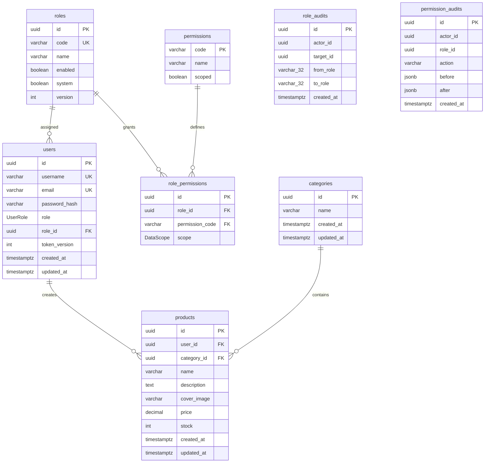
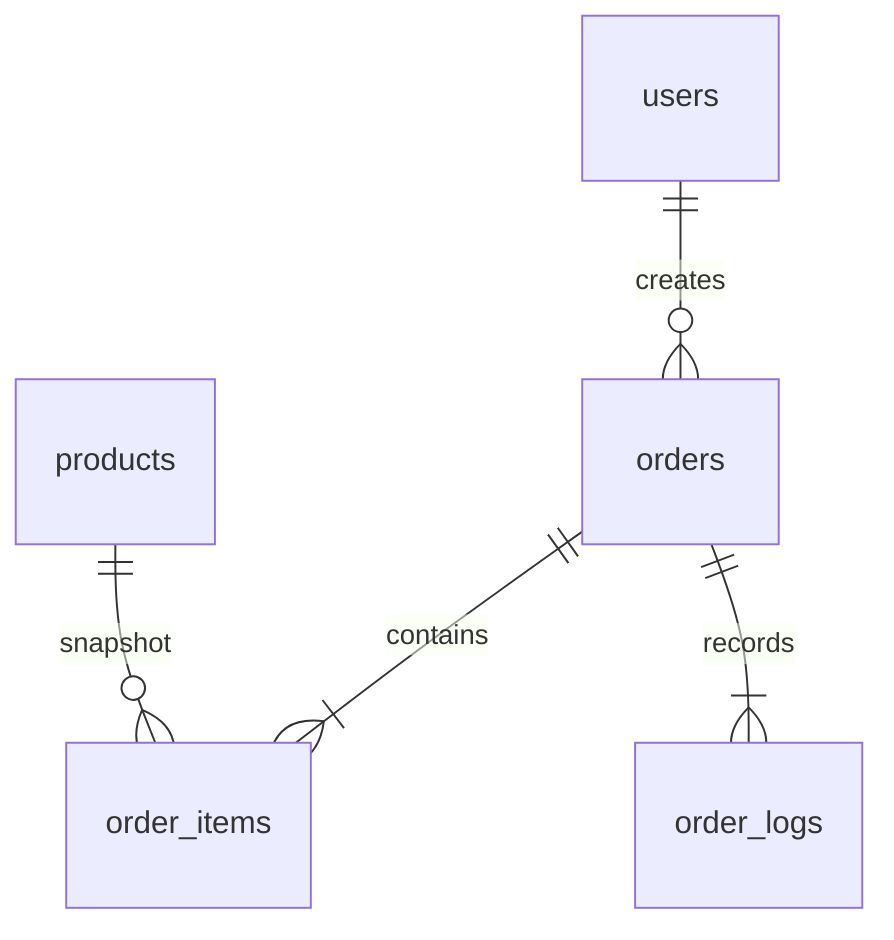
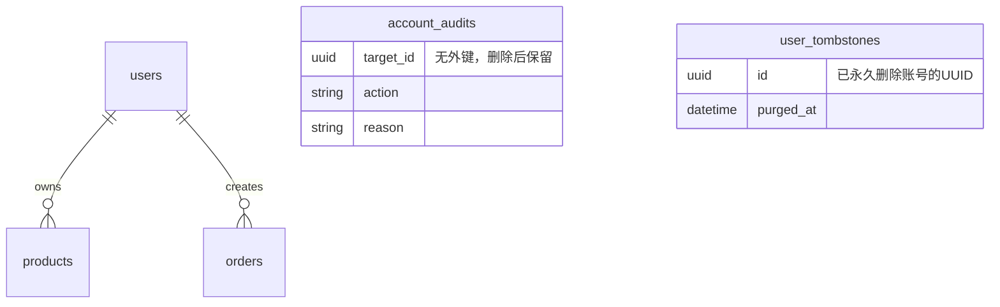

# 数据库设计与本地启动

数据库：PostgreSQL；ORM：Prisma 7 稳定版。使用 `silk_shop` 独立数据库，应用账号为 `silk_shop_app`，不具备超级用户、创建数据库或创建角色权限。



## 字段与约束

- 主键由 PostgreSQL `gen_random_uuid()` 生成；时间使用带时区时间戳，精度为毫秒。
- `users.username` 最长 64 字符、唯一；`email` 最长 254 字符、唯一。认证模块负责 trim、邮箱小写归一化、邮箱格式验证及 BCrypt 哈希；数据库唯一约束区分大小写。
- `password_hash` 最长 255 字符，只存密码哈希。数据库不能代替应用执行密码哈希；接口不得返回该字段。
- `token_version` 对应 Prisma `tokenVersion`，INTEGER NOT NULL DEFAULT 0，用于登录凭证失效；已有用户迁移后为 0，原哈希和其他字段不变。改密时同一事务内更新哈希并递增版本，公开用户资料不返回此内部字段。
- `categories.name` 最长 120 字符。分类层级为可选项，本阶段不增加自关联。
- `products.name` 最长 200 字符，描述为 text，默认空字符串。
- `products.cover_image` 对应 Prisma 的可空 `coverImage` 字段，类型为 VARCHAR(2048)，存储封面 URL；已有商品迁移后为 null，图片二进制保存在上传目录中。
- 金额采用 `Decimal(12,2)`，非负，最大 9,999,999,999.99。API 使用字符串传递金额，避免 JS 浮点误差；超过两位小数应由 DTO 拒绝，PostgreSQL numeric 本身会舍入。
- 库存为非负 32 位整数，默认 0；用户、分类外键均非空。
- 用户名、邮箱、商品名、分类名不能只包含普通空格。非负值及非空白 CHECK 约束通过迁移 SQL 管理，Prisma schema 不表达这些 CHECK；后续迁移需保留。
- 用户或分类被商品引用时使用 `RESTRICT` 禁止删除；先调整/删除关联商品。
- 商品建立创建时间索引、用户+创建时间索引和分类+创建时间索引，支持分页列表。
- `20261103023330_product_list_filter_indexes` 新增 `(stock, created_at)`、`(price, created_at)`、`(updated_at)` 索引，沿用 Prisma 索引命名。复用现有分类+创建时间索引；未引入 status 或可空价格，也不增加无效的名称 B-tree 子串索引。仅 CREATE INDEX，不修改数据、外键、CHECK 或同步触发器。普通建索引会暂时阻塞并发写入，较大数据量应安排维护窗口。
- `updated_at` 由 Prisma `@updatedAt` 在更新时维护；直接写 SQL 时应自行更新。同步触发器单独记录事件时间，不代替维护业务 `updated_at`。

## 配置与迁移

在 backend 目录操作。已有数据库时，复制 `.env.example` 为 `.env`，填写实际 `DATABASE_URL`，然后：

```powershell
cd ..
npm.cmd ci
npm.cmd run db:verify
cd backend
npm.cmd run db:generate
npm.cmd run db:validate
npm.cmd run db:deploy
npm.cmd run start:dev
```

本地首次建库可使用 `scripts/setup-database.ts`：向进程环境提供 `POSTGRES_ADMIN_URL`（具有建库/建角色权限），运行 `npm.cmd run db:setup`。脚本只创建固定的新项目库和新角色，遇到同名资源或已有 `.env` 会终止，不重置密码、不覆盖已有库。专用随机密码只写入被 Git 忽略的 `.env`。若建库中断，不要删库重试，应检查已创建的资源与 `.env` 后人工恢复。

新增模型变更使用 `npm.cmd run db:migrate -- --name change_description --create-only`，在开发库仅生成迁移，审查 SQL 并在隔离库验证后再使用 `db:deploy` 应用。初始化脚本同时创建独立的 `silk_shop_shadow` 影子库，通过 `SHADOW_DATABASE_URL` 配置；专用账号仍无 CREATEDB 权限。影子库只供 Prisma 重建/比较结构，绝不能与主库使用相同地址。已有环境需由管理员预先建立独立影子库。已提交迁移通过 `db:deploy` 应用，不需要影子库。

禁止对已有业务库运行 `migrate reset`。不要把 .env、连接密码或数据库导出提交到 Git。

## 可选双向同步

`20261030040000_bidirectional_sync` 迁移增加三张内部表及业务表的变更捕获触发器：`_sync_identity` 保存本库唯一节点 ID；`_sync_versions` 以表名和记录 UUID 为联合主键，保存微秒精度版本及删除标记；`_sync_events` 用 BIGSERIAL 排队，保存事件 UUID、操作、行 JSON、来源、时间、投递状态与错误码。它们不属于管理后台业务 API，不应手工修改。

两库首次安装迁移会分别捕获已有记录，启动可选同步进程后互相传递。触发器、CHECK、序列默认值由迁移维护；表结构仍通过 Prisma 管理，DDL 不会通过同步进程传播。

## 验证范围

`db:verify` 先生成 Client 并构建，再执行真实 PostgreSQL 验证：Prisma 关联读写、Decimal 精度、更新/删除，重复用户名/邮箱、负价格/库存、非法外键、空白商品名、受引用用户/分类删除。测试记录使用事务回滚，不清空数据库。Nest 的 `test:e2e` 包含数据库模块连接、认证和商品/分类管理共 79 项 HTTP 测试；`npm.cmd test` 联合执行两组数据库验证和全部 HTTP 测试。

数据库初始化不创建默认管理员、不写入演示账号；注册与登录由认证模块提供，使用说明见 [API 文档](api.md)。

2026-10-29 本机验证：初始迁移应用成功，`db:verify` 两组测试通过，`test:e2e` 一项连接测试通过；`db:status` 为最新，数据库与 Prisma schema 比较无差异。PostgreSQL 18 对 RESTRICT 删除返回 `23001`，非法外键插入返回 `23503`。


## 两角色迁移

UserRole 枚举仅 OPERATOR、ADMIN；users.role 非空且默认 OPERATOR。20261104081128_two_roles_admin_registration 在事务中将旧只读账号转换为运营人员并递增 token_version，原有运营人员及管理员不变。role_audits.from_role/to_role 从枚举转换为 VARCHAR(16)，保留历史审计原文；其他账号、密码、商品、分类、同步触发器与索引保留。已应用迁移文件不可改写，空库需按完整迁移链部署。

role_audits 保存 actor_id、target_id、from_role、to_role、created_at，不存密码/令牌，标识不设置级联外键，保留历史操作依据。审计只在发起操作的库落地，用户角色和版本通过现有同步桥传播。

本次 SQL 已经用户审查确认；仅在隔离 schema 验证空库部署与已有账号回填，尚未部署本机 public 或 Docker 业务库。分类本来就是全局独立表，没有按用户的唯一键或归属字段，升级不合并、不删除任何分类。

## 订单与库存扩展

迁移：20261105055343_order_management；保留已有数据，stock_version初始化0。



- orders：UUID主键、唯一order_no、创建者外键RESTRICT、(creator_id,idempotency_key)唯一、SHA256请求指纹、客户/物流信息、状态与时间、Decimal(18,2)总额。索引(creator_id,created_at)/(status,created_at)/created_at。
- order_items：订单CASCADE、商品RESTRICT；(order_id,product_id)唯一。保存名称、封面、Decimal(12,2)单价快照、1–9999数量和Decimal(18,2)小计；CHECK验证小计=单价×数量。
- order_logs：订单外键、操作人ID/名称快照、动作、前后状态与原因。数据库不关联操作人以保留历史快照。
- products.stock_version：库存变化由触发器递增；同步重放保留源版本，不二次递增。
- _commerce_config：内部单例id=1，STANDALONE/PRIMARY/REPLICA；不提供HTTP接口。commerce_write_guard阻止副本直写及主库反向覆盖。
- _sync_events.transaction_id：pg_current_xact_id()::text；按源事务整体重放及确认，失败整组回滚，订单三表也记录同步事件。

双库商品与订单仅主库写入，副本供查询；users/categories继续双向，禁止用旧整行双向产品同步覆盖库存。默认STANDALONE仅用于独立环境；实际双库必须配置互补角色。

## 可配置 RBAC 结构

20261110023925_configurable_rbac 新增 users.role_id 外键并建立索引，指向 roles，删除使用 RESTRICT；legacy role 由数据库触发器保持兼容，不能用它判断自定义角色权限。roles.code 唯一且限制格式；role_permissions 的 (role_id, permission_code) 唯一，范围为 OWN/ALL。permissions 初始为 21 项，账号生命周期迁移扩至 24 项固定目录。permission_audits 不设角色外键，角色删除后仍保留前后快照；RoleAudit 历史编码扩为 VARCHAR(32)。

迁移按原 ADMIN/OPERATOR 回填确定的角色 ID，现有 tokenVersion 加一；不删除业务数据。两库种子 ID/时间一致。角色、权限关联启用同步捕获和 TRUNCATE 保护，副本禁止配置写入；主库角色分配不能被副本旧资料事件覆盖。角色审计留在源库。详见 [RBAC](rbac.md)。

## 账号生命周期结构

迁移 `20261110070741_account_lifecycle` 新增 users.deleted_at（可空时间）、deleted_by（可空 UUID 快照）、delete_reason（可空 VARCHAR(500)），及 (deleted_at,created_at) 索引。不改用户名/邮箱唯一约束，原记录初始化为正常。

- account_audits：UUID 主键、actor_id/target_id UUID 快照、username VARCHAR(64)、action VARCHAR(24)、reason VARCHAR(500)、created_at；索引 (target_id,created_at)。无用户外键，账号硬删除后审计仍保留，仅源库保存。
- user_tombstones：永久用户 UUID 主键、purged_at；不存邮箱或凭据。禁止更新/删除/截断，按主库事务同步；任何后续原 UUID 插入拒绝。
- users 保持 products/orders 的 RESTRICT 外键，软删除不触发级联；硬删除应用再次检查所有业务关联。
- 生命周期写入只允许主库，主库状态通过 `_sync_versions` 中 `user_lifecycle` 独立版本键复制，不受副本资料时钟影响；墓碑阻止任意延迟 UPSERT 复活。该版本键是内部元数据，无对应业务表。


