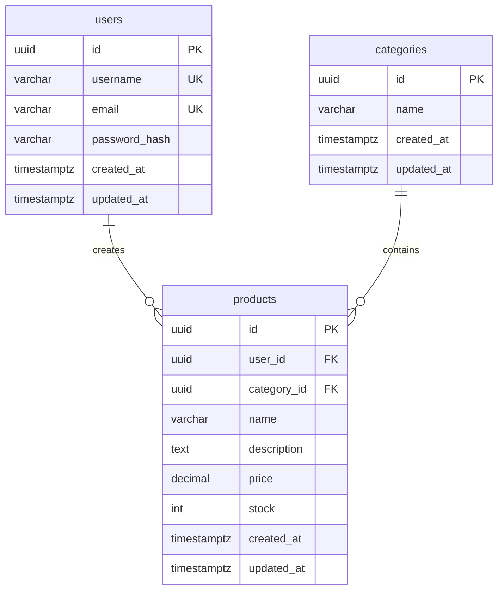

# 数据库设计与本地启动

数据库：PostgreSQL；ORM：Prisma 7 稳定版。使用 `silk_shop` 独立数据库，应用账号为 `silk_shop_app`，不具备超级用户、创建数据库或创建角色权限。



## 字段与约束

- 主键由 PostgreSQL `gen_random_uuid()` 生成；时间使用带时区时间戳，精度为毫秒。
- `users.username` 最长 64 字符、唯一；`email` 最长 254 字符、唯一。认证模块负责 trim、邮箱小写归一化、邮箱格式验证及 BCrypt 哈希；数据库唯一约束区分大小写。
- `password_hash` 最长 255 字符，只存密码哈希。数据库不能代替应用执行密码哈希；接口不得返回该字段。
- `categories.name` 最长 120 字符。分类层级为可选项，本阶段不增加自关联。
- `products.name` 最长 200 字符，描述为 text，默认空字符串。
- 金额采用 `Decimal(12,2)`，非负，最大 9,999,999,999.99。API 使用字符串传递金额，避免 JS 浮点误差；超过两位小数应由 DTO 拒绝，PostgreSQL numeric 本身会舍入。
- 库存为非负 32 位整数，默认 0；用户、分类外键均非空。
- 用户名、邮箱、商品名、分类名不能只包含普通空格。非负值及非空白 CHECK 约束通过迁移 SQL 管理，Prisma schema 不表达这些 CHECK；后续迁移需保留。
- 用户或分类被商品引用时使用 `RESTRICT` 禁止删除；先调整/删除关联商品。
- 商品建立创建时间索引、用户+创建时间索引和分类+创建时间索引，支持分页列表。
- `updated_at` 由 Prisma `@updatedAt` 在更新时维护；直接写 SQL 时应自行更新，不使用触发器。

## 配置与迁移

在 backend 目录操作。已有数据库时，复制 `.env.example` 为 `.env`，填写实际 `DATABASE_URL`，然后：

```powershell
npm.cmd ci
npm.cmd run db:generate
npm.cmd run db:validate
npm.cmd run db:deploy
npm.cmd run db:verify
npm.cmd run start:dev
```

本地首次建库可使用 `scripts/setup-database.ts`：向进程环境提供 `POSTGRES_ADMIN_URL`（具有建库/建角色权限），运行 `npm.cmd run db:setup`。脚本只创建固定的新项目库和新角色，遇到同名资源或已有 `.env` 会终止，不重置密码、不覆盖已有库。专用随机密码只写入被 Git 忽略的 `.env`。若建库中断，不要删库重试，应检查已创建的资源与 `.env` 后人工恢复。

新增模型变更使用 `npm.cmd run db:migrate -- --name change_description`，在开发库生成迁移。初始化脚本同时创建独立的 `silk_shop_shadow` 影子库，通过 `SHADOW_DATABASE_URL` 配置；专用账号仍无 CREATEDB 权限。影子库只供 Prisma 重建/比较结构，绝不能与主库使用相同地址。已有环境需由管理员预先建立独立影子库。已提交迁移通过 `db:deploy` 应用，不需要影子库。

禁止对已有业务库运行 `migrate reset`。不要把 .env、连接密码或数据库导出提交到 Git。

## 验证范围

`db:verify` 先生成 Client 并构建，再执行真实 PostgreSQL 验证：Prisma 关联读写、Decimal 精度、更新/删除，重复用户名/邮箱、负价格/库存、非法外键、空白商品名、受引用用户/分类删除。测试记录使用事务回滚，不清空数据库。Nest 的 `test:e2e` 包含数据库模块连接、认证和商品/分类管理共 79 项 HTTP 测试；`npm.cmd test` 联合执行两组数据库验证和全部 HTTP 测试。

数据库初始化不创建默认管理员、不写入演示账号；注册与登录由认证模块提供，使用说明见 [API 文档](api.md)。

2026-10-29 本机验证：初始迁移应用成功，`db:verify` 两组测试通过，`test:e2e` 一项连接测试通过；`db:status` 为最新，数据库与 Prisma schema 比较无差异。PostgreSQL 18 对 RESTRICT 删除返回 `23001`，非法外键插入返回 `23503`。
